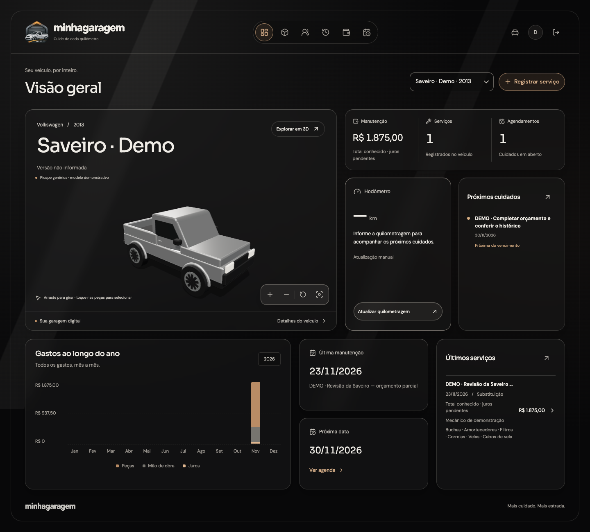
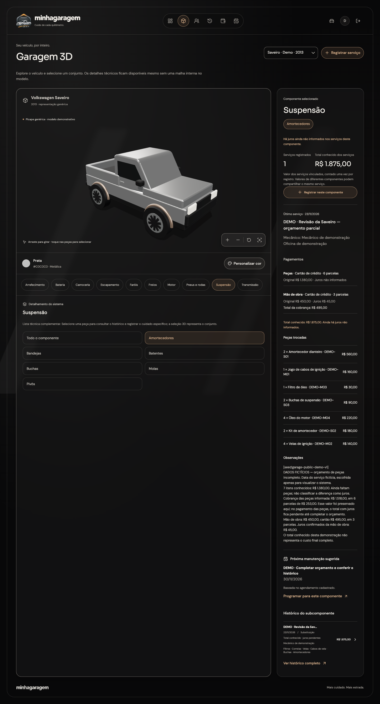
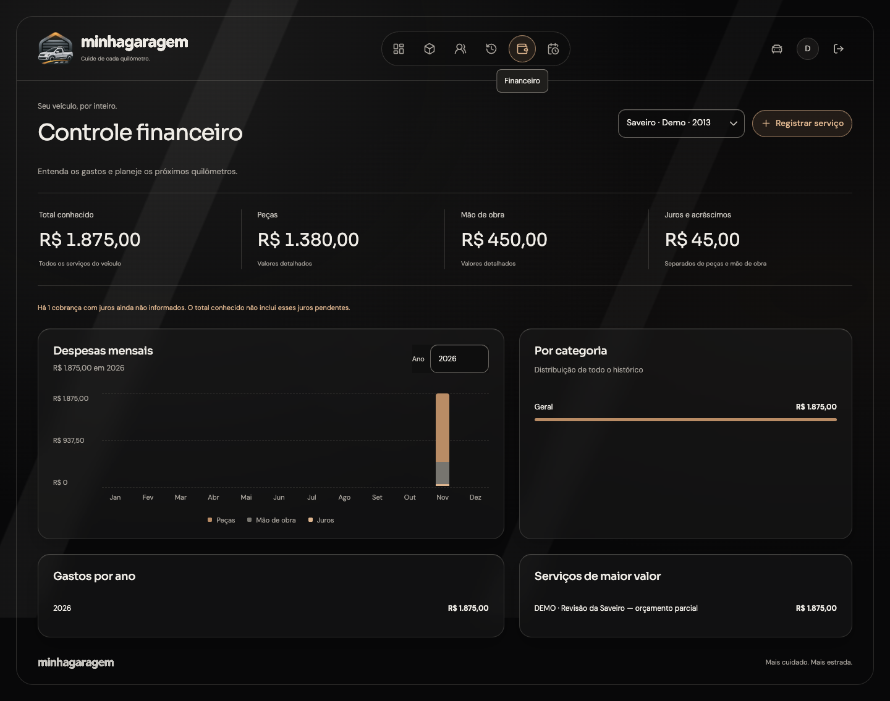

<div align="center">
  
  <h1>Minha Garagem</h1>
  <p>O histórico do seu carro, conectado às peças que você vê.</p>
  <p>Vue 3 · TypeScript · Three.js · ASP.NET Core 10 · PostgreSQL</p>
  <p><a href="https://github.com/leonardo-gmuller/my-garage/actions/workflows/ci.yml"></a></p>
  <p><a href="#executar-localmente">Executar</a> · <a href="#o-que-o-projeto-faz">Funcionalidades</a> · <a href="docs/architecture.md">Arquitetura</a> · <a href="docs/development.md">Desenvolvimento</a></p>
</div>



Minha Garagem é uma aplicação para organizar a manutenção de veículos: registrar o que foi feito, relacionar serviços a componentes e acompanhar peças, pagamentos e próximos cuidados. O visualizador 3D oferece uma forma direta de explorar esse histórico.

Projeto de portfólio construído com frontend Vue, API .NET e persistência real em PostgreSQL. A interface usa vidro fumê, tons neutros e detalhes em cobre.

## O que o projeto faz

- **Garagem 3D:** câmera orbital, zoom, seleção de peças e consulta ao histórico por componente.
- **Manutenção por sistema:** motor, suspensão, freios e outros conjuntos, com subcomponentes técnicos e peças substituídas.
- **Serviços flexíveis:** valores detalhados ou um total fechado para várias trocas, sem duplicar o gasto entre componentes.
- **Pagamentos separados:** peças e mão de obra podem ter parcelas e acréscimos diferentes. Informações desconhecidas ficam pendentes.
- **Financeiro:** totais, categorias, despesas por ano e gráfico mensal com peças, mão de obra e juros separados.
- **Agenda e contatos:** próximos cuidados e agenda privada de mecânicos vinculados aos serviços.
- **Arquivos privados:** fotos e comprovantes associados à manutenção, acessíveis pela conta autenticada.

<details>
<summary>Ver outras telas</summary>

**Componentes e manutenção detalhada**



**Controle financeiro**



**Interface no celular**


Todas as capturas usam dados fictícios e a picape demonstrativa incluída no código.

</details>

## Executar localmente

**Pré-requisitos:** Docker com Compose e Node.js 20.19+ ou 22+ para os comandos auxiliares.

```sh
git clone https://github.com/leonardo-gmuller/my-garage.git
cd my-garage
cp .env.example .env
```

Edite `.env` e preencha suas próprias senhas:

```dotenv
POSTGRES_PASSWORD=
# Preencha as duas senhas no seu arquivo local.
BOOTSTRAP_EMAIL=demo@minhagaragem.local
BOOTSTRAP_PASSWORD=
```

A senha de acesso deve ter de 10 a 128 caracteres, com maiúscula, minúscula e número. Os campos de senha estão vazios de propósito: defina seus próprios valores antes de iniciar.

```sh
docker compose up --build -d
```

Acesse **http://localhost:8080** e entre com o e-mail e a senha definidos no `.env`.

### Primeiro acesso, sem cadastro público

O primeiro usuário é criado na inicialização de um banco vazio. A tela oferece somente login; não existe endpoint público de cadastro. Reiniciar a aplicação ou alterar `BOOTSTRAP_PASSWORD` não redefine a senha de uma conta existente.

A conta inicial recebe uma Saveiro 2013 prata, sem placa, quilometragem ou manutenção inventadas. A visualização 3D da distribuição pública usa a picape demonstrativa incluída no código.

### Explorar com dados fictícios

Mantendo `BOOTSTRAP_EMAIL=demo@minhagaragem.local`, execute:

```sh
make seed
```

O seed usa o acesso já criado pelo `.env` e adiciona um mecânico, uma revisão com peças, pagamentos e um lembrete. É idempotente e preserva alterações feitas na demonstração. [Detalhes do seed](docs/demo-seed.md).

## Arquitetura

```text
src/backend/
  MinhaGaragem.Domain/          Entidades, catálogos e regras de domínio
  MinhaGaragem.Application/     Casos de uso, contratos e cálculos
  MinhaGaragem.Infrastructure/  EF Core, Identity, bootstrap e migrations
  MinhaGaragem.Api/             Endpoints, autenticação e composição
src/frontend/src/
  components/                  Formulários, gráficos e visualizador
  features/three/              Cena 3D, seleção e materiais
  views/                       Telas da aplicação
  services/                    Cliente HTTP e contratos
  stores/                      Sessão e estado da garagem
scripts/                       Desenvolvimento e seed explícito
tests/                         Testes unitários e de integração
```

O backend é um monólito modular com quatro camadas. Valores monetários usam `decimal`; um registro é contabilizado uma única vez, mesmo associado a vários componentes. Autenticação usa cookies HttpOnly, proteção antiforgery e isolamento dos dados por proprietário. [Decisões de arquitetura](docs/architecture.md).

## Desenvolvimento e testes

Com .NET SDK 10, Node.js e Docker instalados:

```sh
make setup
make dev      # API 5081, Vite 5175, PostgreSQL de desenvolvimento 55432
make test     # xUnit + PostgreSQL real em bancos temporários
make lint     # C#, TypeScript e configuração de debug
make build
```

Para testar no navegador, use uma instalação e uma conta de testes isoladas; configure `GARAGE_E2E_EMAIL` e `GARAGE_E2E_PASSWORD` e execute `make test-e2e`. Os testes criam seus próprios veículos e removem apenas seus dados. Os cenários específicos da Saveiro são opcionais quando o asset local não está disponível.

GitHub Actions valida backend, frontend e migrations. [Guia de desenvolvimento e debug](docs/development.md).

## Modelos e créditos

O repositório inclui uma picape demonstrativa gerada pelo próprio código Three.js. O GLB específico da Saveiro, usado no ambiente local de desenvolvimento, **não é redistribuído**, pois sua licença não foi confirmada. O projeto funciona sem ele. A integração opcional está documentada em [modelos 3D](docs/3d-models.md).

Este é um projeto independente, sem vínculo com fabricantes de veículos. Bibliotecas, fontes e outros componentes de terceiros mantêm suas próprias licenças. [Créditos e assets](THIRD_PARTY_NOTICES.md).

## Documentação

- [Arquitetura e decisões](docs/architecture.md)
- [Desenvolvimento, configuração e testes](docs/development.md)
- [Seed fictício](docs/demo-seed.md)
- [Modelo 3D e integração opcional](docs/3d-models.md)
- [Pagamentos e custo da manutenção](docs/maintenance-payments.md)
- [Guia de estudo do backend .NET](docs/dotnet-learning.md)
- [Contribuição](CONTRIBUTING.md) e [segurança](SECURITY.md)

## Licença

Código disponibilizado sob a [licença MIT](LICENSE). Assets externos adicionados localmente não recebem essa licença por associação.
