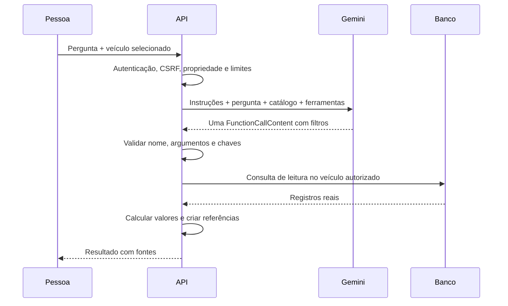

# Assistente do histórico — Fase 2

O assistente permite consultar o veículo selecionado em linguagem natural. Está em **Assistente do histórico**, na navegação, e reutiliza a configuração Gemini da [Fase 1](ai-learning.md). Não cria registros, altera valores ou conclui agendamentos.

## Consultas disponíveis

| Pergunta | Ferramenta | Fonte |
| --- | --- | --- |
| Quando troquei as velas? | `ultimo_servico` | Último serviço associado ao subcomponente cadastrado |
| Quanto gastei com suspensão em 2026? | `consultar_gastos` | Serviços vinculados ao conjunto, no ano solicitado |
| Quais manutenções estão pendentes? | `consultar_pendencias` | Agendamentos ainda não concluídos, incluindo atrasados |
| Quando foi a última revisão? | `ultimo_servico` | Busca literal na descrição do serviço |

O primeiro incremento aceita um componente/subcomponente por pergunta, todo o período registrado ou um ano civil. Meses e intervalos pedem esclarecimento. Não existe memória de conversa: cada pergunta precisa conter seus filtros. “Último serviço” significa o último registro encontrado no recorte; não comprova uma troca que não tenha sido registrada nem valida o diagnóstico mecânico.

## Uma chamada ao modelo; uma consulta autorizada



[HistoryAssistant](../src/backend/MinhaGaragem.Application/AI/HistoryAssistant.cs) usa `IChatClient`, `AIFunctionFactory` e `ChatToolMode.RequireAny` de Microsoft.Extensions.AI. O adaptador oficial do Gemini transporta as declarações e converte a resposta em `FunctionCallContent`.

A execução é explícita: o backend aceita exatamente uma chamada entre quatro funções conhecidas. A quarta, `esclarecer_pergunta`, retorna orientação quando a consulta não cabe no escopo. Nomes desconhecidos, chamadas múltiplas, campos extras, ano inventado e chaves de outro catálogo são rejeitados. Não há ferramentas de SQL, escrita, HTTP arbitrário ou acesso a arquivos.

As funções capturam o veículo já autorizado no servidor. O modelo recebe chaves de catálogo, nunca UUIDs, usuário ou identificadores de outro veículo. A consulta revalida o pertencimento antes de acessar os dados. As expressões LINQ são definidas pelo código; o modelo fornece somente filtros tipados e limitados.

O backend invoca a função com `AIFunction.InvokeAsync`. **Não há ciclo automático de ferramentas nem segunda chamada de síntese.** O texto, os valores, as datas e os links apresentados são montados com os dados retornados pelo banco. Resultados das ferramentas e histórico não voltam ao modelo. Essa decisão mantém o primeiro incremento verificável e reduz envio de dados e consumo de tokens.

## Valores e referências

[HistoryQueries](../src/backend/MinhaGaragem.Application/AI/HistoryQueries.cs) reutiliza os custos do domínio e `FinancialSummary.Calculate`. Um serviço com vários componentes entra uma única vez no total da consulta. Valores fechados não são divididos artificialmente entre peças. Juros conhecidos entram no valor; cobranças sem total final recebem aviso de pendência.

Quando se filtra um componente, o valor corresponde aos **serviços associados**, não ao preço isolado daquele componente. Totais de componentes diferentes podem conter a mesma visita e não devem ser somados.

O resultado mostra até cinco fontes recentes. O total considera o recorte completo até 2.000 registros. Acima disso, o backend solicita um filtro mais específico, sem exibir soma parcial. A consulta do último serviço busca somente o primeiro registro ordenado por data, criação e ID.

Os links de serviço abrem o histórico com `vehicle` e `record` na URL, usando o endpoint autenticado existente para carregar aquele registro. O vínculo funciona ao recarregar a página. A interface monta rotas internas com IDs do backend, sem usar URLs produzidas pelo modelo. Agendamentos abrem a agenda do veículo correspondente.

## API e configuração

```http
POST /api/ai/assistant/ask
Content-Type: application/json
X-CSRF-TOKEN: <token da sessão>
```

```json
{
  "vehicleId": "<id de um veículo da conta>",
  "question": "Quanto gastei com suspensão em 2026?"
}
```

A resposta contém `kind`, `scope`, `message`, `count`, `total` quando aplicável, pendências financeiras, serviços, agendamentos e avisos. Datas e valores desconhecidos continuam ausentes. Histórico vazio é informado explicitamente, sem afirmar que um serviço nunca foi realizado.

Não há novas variáveis de ambiente, tabelas ou migrations. As cotas por minuto/dia e o limite de duas chamadas simultâneas são **compartilhados** com Registrar com IA. O assistente usa no máximo 1.024 tokens de saída, respeitando um limite configurado menor. Timeout, cancelamento, falhas e métricas usam a infraestrutura da Fase 1. Não há tentativas automáticas nem geração em streaming.

## Privacidade e interface

São enviados ao Gemini a pergunta, a data atual e os mesmos dados básicos/catálogo da Fase 1. Não são enviados histórico, totais, agendamentos, anexos, contatos, placa, apelido ou e-mail. O texto livre pode conter dados pessoais: a interface informa o envio e pede que sejam evitados. As condições de uso de dados do provedor continuam aplicáveis; consulte [o guia de IA](ai-learning.md#11-privacidade-observabilidade-e-custos).

A tela utiliza PrimeVue e os tokens existentes de vidro fumê. Respostas não são persistidas no banco ou no navegador. Trocar o veículo ou sair da tela cancela a requisição e descarta a resposta. Falhas preservam a pergunta para nova tentativa; sem configuração, os atalhos de consulta manual continuam disponíveis.

## Testes e limites desta entrega

- `make test`: suíte completa, com autorização, CSRF, filtros, consultas reais em PostgreSQL, totais fechados, juros, limite de registros e fontes. Os testes nunca usam a chave real.
- `make ai-test`: testes das duas fases, usando `IChatClient` fake. O teste do adaptador usa somente HTTP local e comprova que tool calling não executa a função automaticamente.
- `npm run test:e2e -- e2e/history-assistant.spec.ts`: desktop/mobile, consulta, cancelamento, indisponibilidade e abertura/reabertura de registro real. Somente a resposta de IA é interceptada nesses testes.

Em 23/11/2026, a tentativa real de tool calling retornou indisponibilidade (503), sem gravação. A verificação mínima do provedor realizada no fechamento da Fase 1 também recebeu HTTP 504. Não foi observada inferência externa bem-sucedida nesta rodada.

Os testes com cliente fake e servidor local não comprovam disponibilidade ou qualidade do modelo real. Consulte o resultado da verificação da instalação antes de tratar uma inferência externa como aprovada.

Não estão incluídos diagnóstico automotivo, operações de escrita, múltiplos veículos por pergunta, OCR de notas ou RAG de manuais.

Leituras oficiais: [ferramentas em .NET](https://learn.microsoft.com/en-us/dotnet/ai/conceptual/ai-tools) e [IChatClient](https://learn.microsoft.com/en-us/dotnet/ai/ichatclient).
